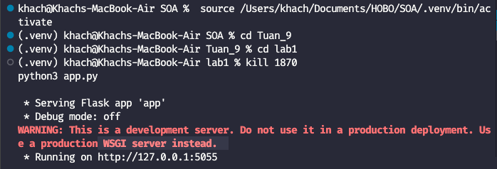
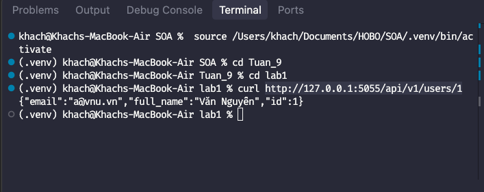
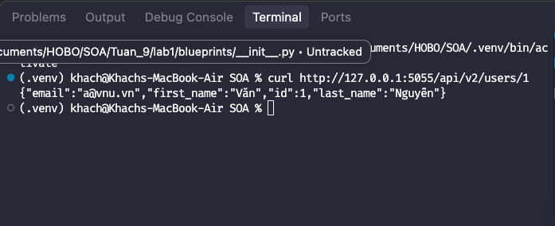
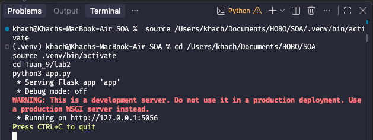
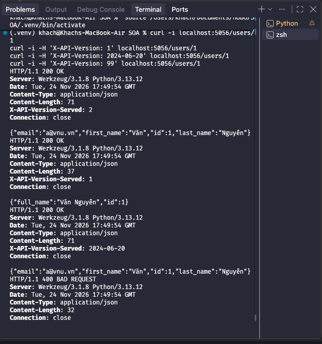
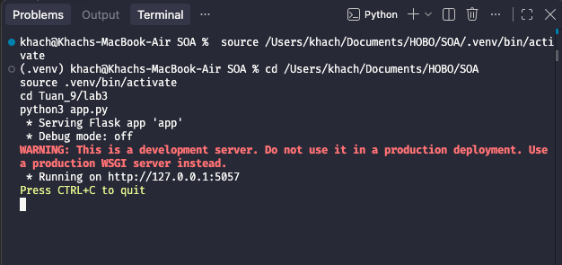
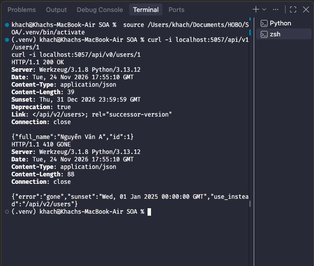
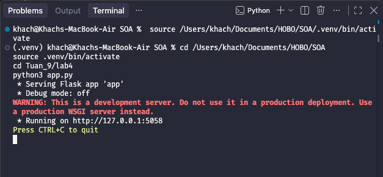
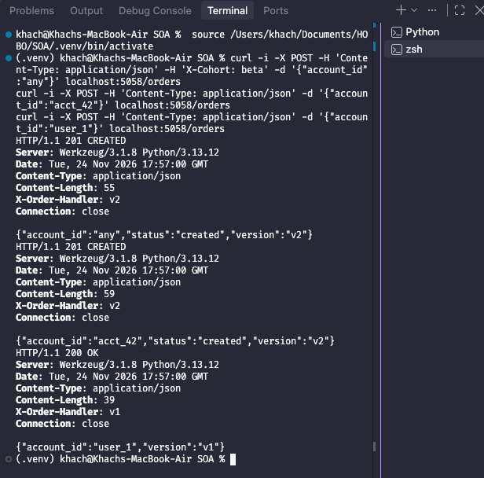

# Tuần 9 - API Versioning

## Lab 1 - URI Path Versioning (port 5055)

```
cd Tuan_9/lab1
python3 app.py
curl localhost:5055/api/v1/users/1
curl localhost:5055/api/v2/users/1
```







## Lab 2 - Header Versioning (port 5056)

```
cd Tuan_9/lab2
python3 app.py
```

```
curl -i localhost:5056/users/1
curl -i -H 'X-API-Version: 1' localhost:5056/users/1
curl -i -H 'X-API-Version: 2024-06-20' localhost:5056/users/1
curl -i -H 'X-API-Version: 99' localhost:5056/users/1
```





## Lab 3 - Sunset Middleware (port 5057)

```
cd Tuan_9/lab3
python3 app.py
```

```
curl -i localhost:5057/api/v1/users/1
curl -i localhost:5057/api/v0/users/1
```





## Lab 4 - Blue-Green Routing (port 5058)

```
cd Tuan_9/lab4
python3 app.py
```

```
curl -i -X POST -H 'Content-Type: application/json' -H 'X-Cohort: beta' -d '{"account_id":"any"}' localhost:5058/orders
curl -i -X POST -H 'Content-Type: application/json' -d '{"account_id":"acct_42"}' localhost:5058/orders
curl -i -X POST -H 'Content-Type: application/json' -d '{"account_id":"user_1"}' localhost:5058/orders
```





## Test tự động

```
cd Tuan_9/lab2 && python3 test_lab2.py
cd Tuan_9/lab3 && python3 test_lab3.py
cd Tuan_9/lab4 && python3 test_lab4.py
```
